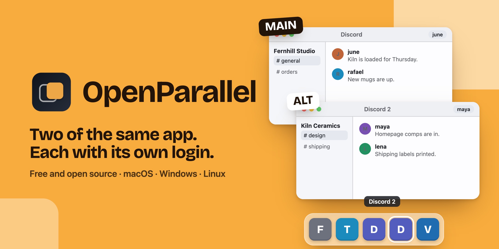
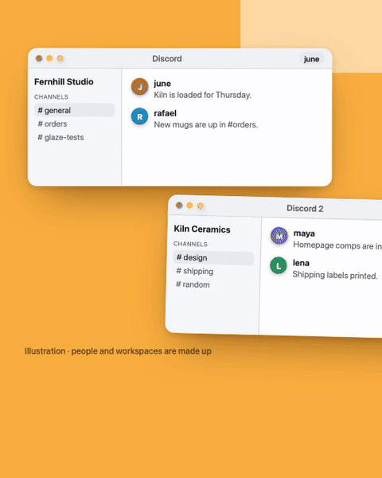
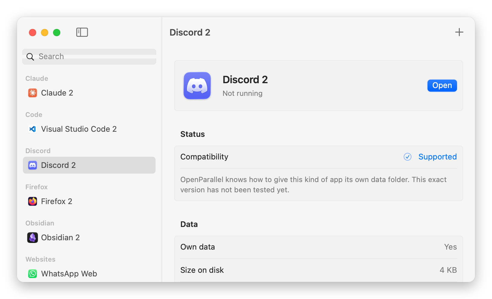
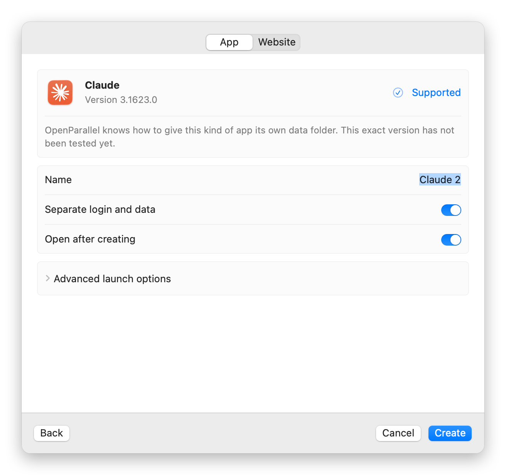
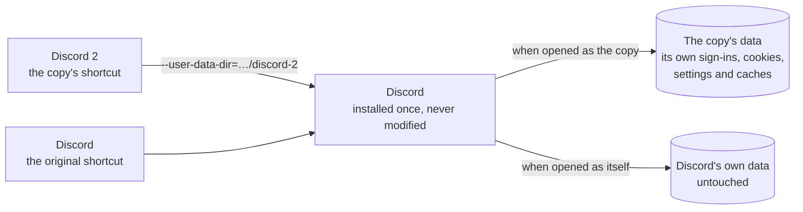

<p align="center">
  
</p>

<p align="center">
  <b>Run a second copy of a desktop app you already have, signed in to another account, beside the first.</b><br>
  The original app is never modified. Free and open source for macOS, Windows and Linux.
</p>

<p align="center">
  <a href="LICENSE"></a>
  
  
  
  <a href="https://github.com/Ali-expandings/openparallel/actions/workflows/ci.yml"></a>
  
  <a href="https://openparallel.pages.dev"></a>
</p>

<p align="center">
  <a href="https://www.youtube.com/@who_tf_is_ali"></a>
  <a href="https://www.instagram.com/ali_the_tech_butcher/"></a>
  <a href="https://linktr.ee/ali_tech_space"></a>
</p>

<p align="center">
  <a href="#download">Download</a> ·
  <a href="#how-it-works">How it works</a> ·
  <a href="#compatibility">Compatibility</a> ·
  <a href="#what-it-will-never-do">What it will never do</a> ·
  <a href="#build-from-source">Build from source</a> ·
  <a href="#faq">FAQ</a> ·
  <a href="#report-a-problem">Report a problem</a>
</p>

<p align="center">
  
  <br><sub>Illustration. The people and workspaces in it are made up.</sub>
</p>

---

You have a work Discord and a personal one. A client's Claude and your own. Two Telegram numbers, two GitHub accounts in VS Code. Every switch means signing out, signing in, and losing your place.

OpenParallel gives you **a second copy of the app**, called `Discord 2` unless you rename it. It opens from the Dock, Start menu or app launcher like any other app, and it signs in to the other account and stays there. The copy runs the very app you installed, so it updates when the original does. What it gets is its own place for everything that makes an account yours.

## Highlights

- **The app you copy is never touched.** No patching, no re-signing, no copied app bundles. The vendor's code signature and entitlements stay intact, and updates keep working.
- **Each copy keeps its own sign-ins and data:** its own cookies, settings, extensions and caches, in a folder of its own.
- **Honest compatibility.** Every app gets a status from what was actually shown, never rounded up: [26 apps and 36 exact versions tested on macOS](REAL_APP_TEST_MATRIX.md), each one run as two copies with separate processes and separate data.
- **Websites too.** Any site as its own app window with its own cookies: a second WhatsApp Web, Gmail or Slack.
- **Private by construction.** No account, no analytics, no telemetry, no background service. OpenParallel makes no network connections of its own.
- **Reversible.** Removing a copy moves its shortcut and data to the Trash or Recycle Bin, so a mistake can be undone.
- **Native on every system.** SwiftUI on macOS; Avalonia with Fluent design on Windows and Linux, so it looks like the rest of the computer.

## The app

<p align="center">
  <picture>
    <source media="(prefers-color-scheme: dark)" srcset="docs/media/macos-app-dark.png">
    
  </picture>
</p>

<p align="center">
  <picture>
    <source media="(prefers-color-scheme: dark)" srcset="docs/media/macos-new-instance-dark.png">
    
  </picture>
  <br><sub>The macOS app built from this repository, showing a sample library. Versions that haven't been tested yet say so.</sub>
</p>

## Download

| System | Status | Get it | Requires |
|---|---|---|---|
| **macOS** | Stable (1.0) | [OpenParallel-1.0.0-mac.zip](https://github.com/Ali-expandings/openparallel/releases/latest/download/OpenParallel-1.0.0-mac.zip), or [build from source](#macos) | macOS 14 Sonoma or later, Apple silicon or Intel |
| **Windows** | Beta | [OpenParallel-1.0.0-windows-x64.zip](https://github.com/Ali-expandings/openparallel/releases/latest/download/OpenParallel-1.0.0-windows-x64.zip), or [build from source](#windows-and-linux) | Windows 10 or 11, 64-bit |
| **Linux** | Beta | [x64](https://github.com/Ali-expandings/openparallel/releases/latest/download/OpenParallel-1.0.0-linux-x64.tar.gz) or [arm64](https://github.com/Ali-expandings/openparallel/releases/latest/download/OpenParallel-1.0.0-linux-arm64.tar.gz) tarball with an installer script, or [build from source](#windows-and-linux) | 64-bit Linux desktop (X11 or Wayland) |

Every release lists SHA-256 checksums on the [Releases](https://github.com/Ali-expandings/openparallel/releases) page. The downloads aren't signed with a paid certificate yet: on macOS, if it's blocked, open System Settings → Privacy & Security and choose **Open Anyway**; on Windows, extract the zip first, then choose **More info → Run anyway** if SmartScreen asks.

## How it works

A copy is two small things: **a launcher** and **a data folder**. The launcher starts the app you installed and points it at the copy's folder, using whatever switch that kind of app understands.



| Separate in every copy | Shared with the original |
|---|---|
| Sign-ins and the accounts behind them | The program itself: installed once, updated once |
| Cookies, history and site data | Your documents and folders, as with any app |
| Settings, extensions, themes and caches | |
| Its own name and icon in the Dock, Start menu or app launcher | |

### Recipes

OpenParallel inspects the app, recognises what it's built with, and uses the switch that app family already supports. When there isn't one, it says so.

| App family | How a copy gets its own data | Examples |
|---|---|---|
| Electron | `--user-data-dir` (plus app-specific variables where needed) | Claude, Discord, Obsidian, Signal |
| Chromium browsers | `--user-data-dir` and a separate disk cache | Chrome, Brave, Vivaldi, Edge |
| VS Code family | `--user-data-dir` and `--extensions-dir`; the copy leaves updating to the original | VS Code, Cursor, Windsurf, Antigravity IDE |
| Firefox family | `-profile` and `-no-remote` | Firefox, Zen, LibreWolf, Tor Browser |
| Telegram Desktop | `-many` and its own `-workdir` | Telegram |
| JetBrains IDEs | a per-copy `idea.properties` (config, system, plugins, logs) | IntelliJ IDEA, PyCharm, WebStorm |
| Websites | a separate website-data store (macOS WebKit) or browser profile in app mode | WhatsApp Web, Gmail, Slack |

<details>
<summary><b>Platform details</b></summary>

**macOS.** Copies are tiny `.app` launchers in `~/Applications/OpenParallel Shortcuts/` that start the vendor-signed app with the copy's profile. Recipe-based copies keep your real `HOME`, so files, keychain, DNS and terminal access behave normally; a few apps without a recipe can use a clearly labelled, experimental per-copy `HOME`. Data lives in `~/Library/Application Support/OpenParallel/Instances/<copy>/`. Website copies use macOS WebKit with a persistent data store per copy.

**Windows.** Copies are Start menu shortcuts (and, if you like, desktop shortcuts) with their own icon and taskbar identity. Squirrel-installed apps start through their `Update.exe`, so the copy always opens the newest version. Microsoft Store apps built on Electron start through Windows' own activation API with the copy's arguments *(experimental)*. Data lives in `%LOCALAPPDATA%\OpenParallel\Instances\<copy>\`.

**Linux.** Copies are freedesktop desktop entries with their own window class, so most show up separately in the dock (a Snap browser's copy shares the original's dock icon on Wayland). Flatpak apps run with `flatpak run` and access to the copy's folder only; Snaps keep data in the snap's own folder; AppImages keep working when the file is replaced by a newer version. Data lives in `~/.local/share/OpenParallel/Instances/<copy>/`.

</details>

## Compatibility

Statuses are the same words in the apps, on the [website](https://openparallel.pages.dev/apps/) and here:

| Status | What it means |
|---|---|
| **Verified** | A real sign-in and sign-out test confirmed the app keeps accounts apart. |
| **Tested** | This exact version ran as two copies with separate processes and separate data. |
| **Supported** | A recipe exists for this kind of app; this version hasn't been tested yet. |
| **Experimental** | A best-effort recipe. Test before relying on it. |
| **Shares data** | Another copy can open, but it uses the same account and data as the original. |
| **Not supported** | The system or the app allows only one copy, so OpenParallel won't pretend. |

**Tested on macOS (26 apps, 36 exact versions):** Anki, Antigravity, Antigravity IDE, Audacity, Brave Browser, Claude, Codex, Cursor, DBeaver Community, Discord, Firefox, Gemini, Ghostty, iTerm2, Obsidian, OpenCode, Openscreen, Screen Studio, Signal, Spotify, Sublime Text, Telegram Desktop, Tor Browser, Visual Studio Code, Vivaldi and Zen. Every version, bundle ID and recipe is in [REAL_APP_TEST_MATRIX.md](REAL_APP_TEST_MATRIX.md). These are process-and-profile tests: two copies, two processes, two data folders. Account-level checks move an app to **Verified**.

**Windows and Linux** run the same recipes. First real-machine tests (October 2026): on Windows 11, Firefox, Cursor, Antigravity and Claude from the Microsoft Store (a ChatGPT copy works too, but Codex inside it shares the original's sign-in there); on Ubuntu 24.04, Claude, ChatGPT with Codex, Antigravity, Cursor, Visual Studio Code, the Firefox, Thunderbird and Chromium Snaps and a website instance. Versions are in [REAL_APP_TEST_MATRIX.md](REAL_APP_TEST_MATRIX.md); other apps count as **Supported** until tested.

**Not supported, and what to use instead:**

| App | Why | Instead |
|---|---|---|
| WhatsApp (native app) | One bundle identifier and storage container: a second process opens the same account | A website copy of `web.whatsapp.com` |
| Zoom, Steam, Microsoft Office | The app allows only one running copy per computer | A website copy, where the service has one |
| Telegram Lite (Mac App Store) | The sandboxed build rejected a second copy in a real test | Telegram Desktop from telegram.org |
| Safari and other Apple apps | System-managed containers | A different browser |

Missing an app? [Ask for it](https://github.com/Ali-expandings/openparallel/issues/new?template=app_request.yml); a test report is what moves a status up.

## What it will never do

- **Never** modify, patch, re-sign or copy the apps you make copies of.
- **Never** read your passwords, keychain items or tokens.
- **Never** send anything anywhere: no account, no analytics, no crash reporting, no update checks. Your copies talk to their own services exactly as the original app does.
- **Never** run in the background. OpenParallel runs only while you have it open; a copy is a shortcut and a folder.
- **Never** delete for good. Removing a copy moves it to the Trash or Recycle Bin.
- **Never** claim more than was tested. An app update sends a Tested app back to Supported until it's tested again.

## Report a problem

Every OpenParallel app has **Report a problem** (Help menu on macOS; the sidebar or <kbd>F1</kbd> on Windows and Linux; and on each copy's page, where it fills in the app, version and status for you). It builds a plain report you can read first, then sends it from your own mail app or opens a GitHub issue, or you can copy it. Nothing is sent by OpenParallel itself.

You can also use the [report page on the website](https://openparallel.pages.dev/report/) or open an issue directly:

- [Something doesn't work](https://github.com/Ali-expandings/openparallel/issues/new?template=bug_report.yml)
- [An app doesn't keep its data separate](https://github.com/Ali-expandings/openparallel/issues/new?template=separate_data.yml)
- [An idea, or an app to support](https://github.com/Ali-expandings/openparallel/issues/new?template=app_request.yml)

Security issues: please report privately, see [SECURITY.md](SECURITY.md).

## Build from source

### macOS

Requirements: macOS 14 or later and the Swift 6 toolchain (Xcode or the Command Line Tools).

```sh
./scripts/test.sh          # unit tests (swift-testing)
./scripts/build-app.sh     # universal build: dist/OpenParallel.app, .zip and .sha256
open dist/OpenParallel.app
```

`build-app.sh` signs ad hoc by default. A distributable build needs a Developer ID certificate and notarization:

```sh
SIGN_IDENTITY="Developer ID Application: Example (TEAMID)" NOTARY_PROFILE="openparallel-notary" ./scripts/build-app.sh
```

The app doubles as a command-line tool:

```sh
OpenParallel inspect --src /Applications/Claude.app --json      # what a copy would get
OpenParallel build --src /Applications/Claude.app               # make a copy
OpenParallel web-build --url https://web.whatsapp.com --name "WhatsApp Web"   # a website copy
./scripts/real-app-smoke-test.sh --app /Applications/Firefox.app --instances 2
```

### Windows and Linux

One .NET solution serves both (`desktop/`). Requirements: the [.NET 10 SDK](https://dotnet.microsoft.com/download).

```sh
cd desktop
dotnet test --project tests/OpenParallel.Core.Tests     # engine tests, run on any OS
scripts/build.sh --zip                                  # Windows: self-contained win-x64 zip
scripts/build-linux.sh --package                        # Linux: x64 and arm64 tarballs
```

The Windows build can be produced and end-to-end tested on a Mac (`scripts/wine-test.sh` runs it in a Wine bottle). `opctl` is the command-line companion on both systems. More in [desktop/README.md](desktop/README.md).

### Website

The site in `web/` is static HTML, CSS and a little JavaScript, with no framework and no third-party requests. `web/build.sh` assembles it; `web/deploy.sh` publishes it to Cloudflare Pages.

## Repository layout

```text
Sources/OpenParallel/    macOS app and CLI (SwiftUI): engine, recipes, tested-version records, UI
Tests/                   macOS unit tests
scripts/                 macOS build, test, release checks and real-app smoke tests
desktop/                 Windows and Linux (.NET 10, Avalonia + FluentAvalonia)
  src/OpenParallel.Core/   shared engine: inspection, recipes, launching, recognition
  src/OpenParallel.App/    the desktop app
  src/OpenParallel.Cli/    opctl
  tests/                   engine tests and stand-in fixture apps
  packaging/linux/         install and uninstall scripts
web/                     website (static) and its Cloudflare Pages function
docs/media/              README images and their sources
project.json             public facts every app and the site read (version, report address, downloads)
PRODUCT.md               what OpenParallel is, who it's for, and what it never claims
```

## Roadmap

- [x] macOS app: library, new instance, website instances, menu bar, Move to Trash
- [x] 26 apps / 36 versions tested on macOS
- [x] Windows app with the same engine (Start menu shortcuts, Squirrel, Microsoft Store apps)
- [x] Linux app (desktop entries, Flatpak, Snap, AppImage)
- [x] Report a problem in every app and on the website
- [x] Website: [openparallel.pages.dev](https://openparallel.pages.dev)
- [x] First public release (v1.0) with downloads and checksums for every system
- [ ] Signed and notarized macOS build; code-signed Windows build
- [x] First real-machine tests on Windows 11 and Ubuntu 24.04
- [ ] Longer real-machine compatibility lists for Windows and Linux
- [ ] Account-level **Verified** tests for the most-used apps
- [ ] Homebrew cask, winget and Flathub packages

## FAQ

<details>
<summary><b>Does OpenParallel change the apps I copy?</b></summary>

No. It never writes into an app's folder or bundle. A copy is a launcher plus a data folder; the original app and its own data stay exactly as they were.
</details>

<details>
<summary><b>Do copies get app updates?</b></summary>

Yes. A copy runs the app you installed, so when the original updates, the copy runs the new version. Copies of VS Code-style editors leave updating to the original, so two updaters never fight over one install.
</details>

<details>
<summary><b>Why does macOS or Windows warn me when I open it?</b></summary>

Downloaded builds aren't signed with a paid certificate yet (a build you make yourself on your own Mac opens normally). On macOS, if it's blocked, open System Settings → Privacy & Security and choose Open Anyway; on Windows, choose More info → Run anyway. Signed releases are on the roadmap.
</details>

<details>
<summary><b>Where does a copy keep its data, and how do I remove it?</b></summary>

In OpenParallel's own folder (paths under [Platform details](#how-it-works)). Use **Move to Trash** (macOS) or **Move to Recycle Bin** (Windows) on the copy's page: the shortcut and its data go together, and you can put them back.
</details>

<details>
<summary><b>Why isn't my app supported?</b></summary>

Some apps allow only one running copy per computer, or keep their data in a place the system shares between copies. OpenParallel reports that instead of hacking around it, and suggests a website copy where the service has one.
</details>

<details>
<summary><b>Is it OK to use two accounts?</b></summary>

OpenParallel keeps your work and personal lives apart; it doesn't get around anyone's rules. Each service's own terms still apply to how many accounts you hold and how you use them.
</details>

<details>
<summary><b>How does it relate to Parall?</b></summary>

OpenParallel is an independent project, not affiliated with Parall. Parall is a paid Mac app that does a similar job; if you want a supported Mac app, it's worth a look. OpenParallel is free and open source, and also runs on Windows and Linux.

Version 1.0.0 used Parall's public compatibility list as a fallback for Mac apps OpenParallel hadn't tested yet. From 1.0.1 on, every status and recipe comes from OpenParallel's own tests.
</details>

## Contributing

Bug reports with an app name and version, test reports for apps on your machine, and recipes for new app families are the most useful contributions. Start with [CONTRIBUTING.md](CONTRIBUTING.md); everyone taking part follows the [Code of Conduct](CODE_OF_CONDUCT.md).

## Built with

[Swift](https://www.swift.org) and SwiftUI · [.NET](https://dotnet.microsoft.com) · [Avalonia UI](https://avaloniaui.net) · [FluentAvalonia](https://github.com/amwx/FluentAvalonia) · [xUnit](https://xunit.net) · the [freedesktop.org](https://specifications.freedesktop.org) desktop entry, base directory and trash specifications · [Bricolage Grotesque](https://fonts.google.com/specimen/Bricolage+Grotesque) (OFL) on the website · [Cloudflare Pages](https://pages.cloudflare.com) for hosting.

## License

[MIT](LICENSE). Apps shown in screenshots and illustrations belong to their makers, who aren't involved with OpenParallel.
